# FastAPI Task & Project Management API

A simple, full-stack RESTful application built with **FastAPI**, **SQLAlchemy ORM**, and **MySQL**, featuring comprehensive CRUD workflows, relational database mapping, sorting, filtering, and interactive Swagger UI documentation.

---

## Application Screenshots & Workflow Demonstration

### 1. Database & Workbench Setup
Visualizing database schema, active tables (`project`, `task`), and persisted records via **MySQL Workbench**.

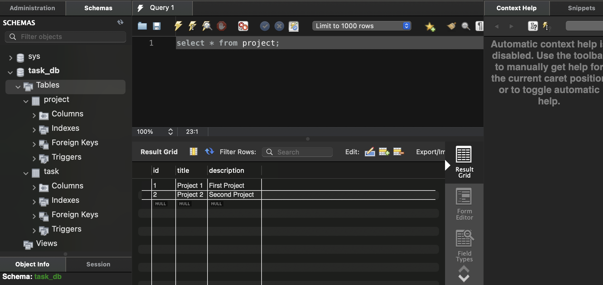

---

### 2. Interactive API Documentation
FastAPI automatically serves interactive Swagger UI documentation at `/docs` for testing all endpoints.

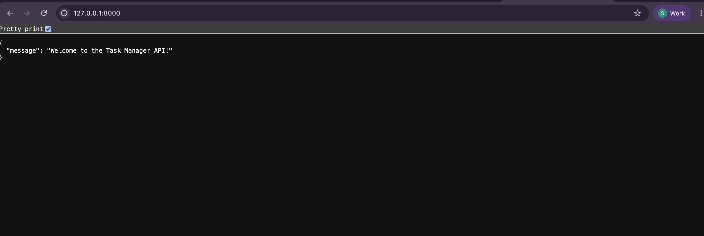

---

### 3. Project Management Workflow

#### Display & Query Projects
* **All Projects List:**  
  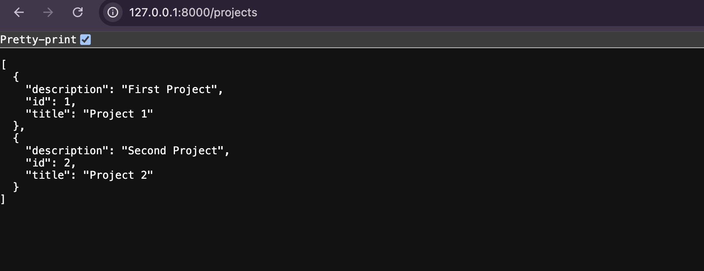

* **All Projects Endpoint Output:**  
  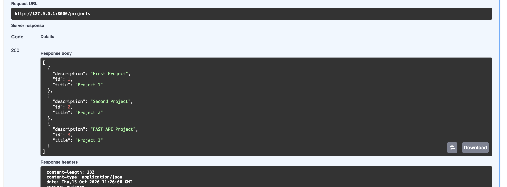

* **Fetch Single Project by ID:**  
  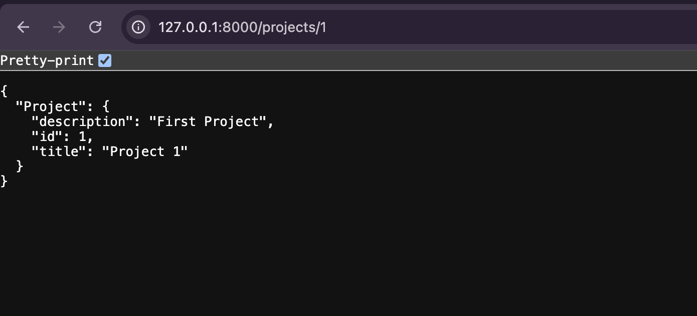

#### Create Project
* **Creating a New Project:**  
  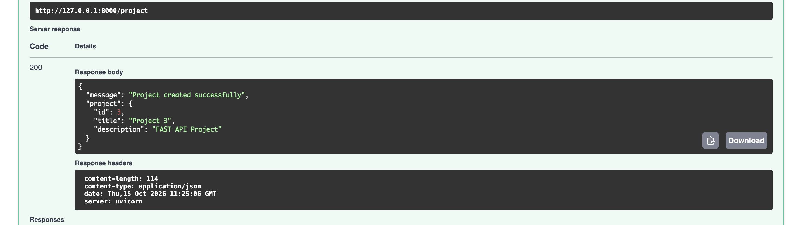

#### Update Project
* **Before Project Update:**  
  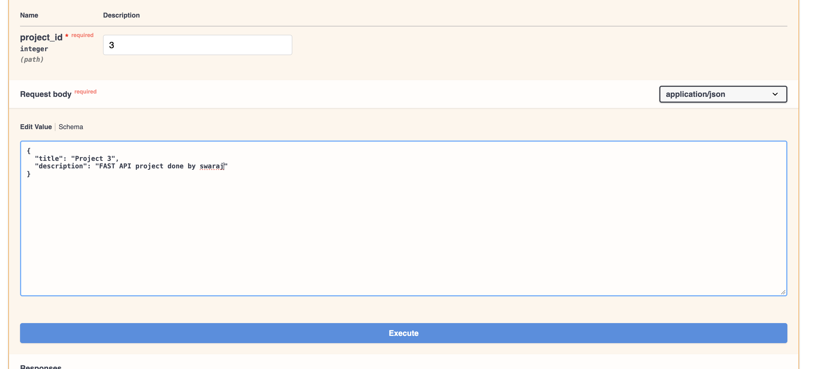

* **After Project Update:**  
  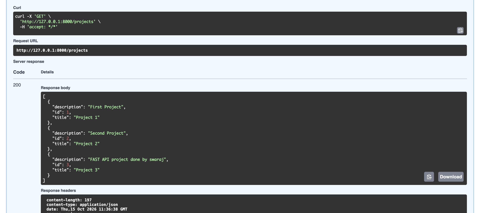

#### Delete Project
* **Before Project Deletion:**  
  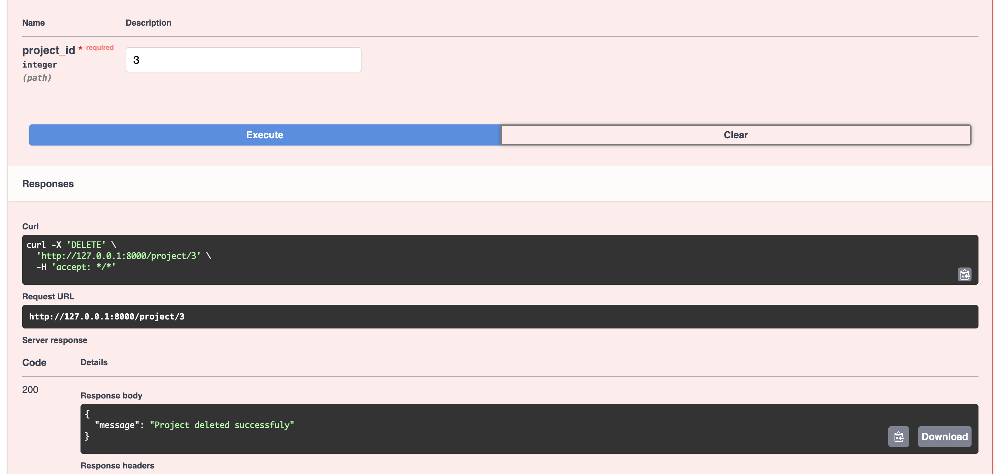

* **After Project Deletion:**  
  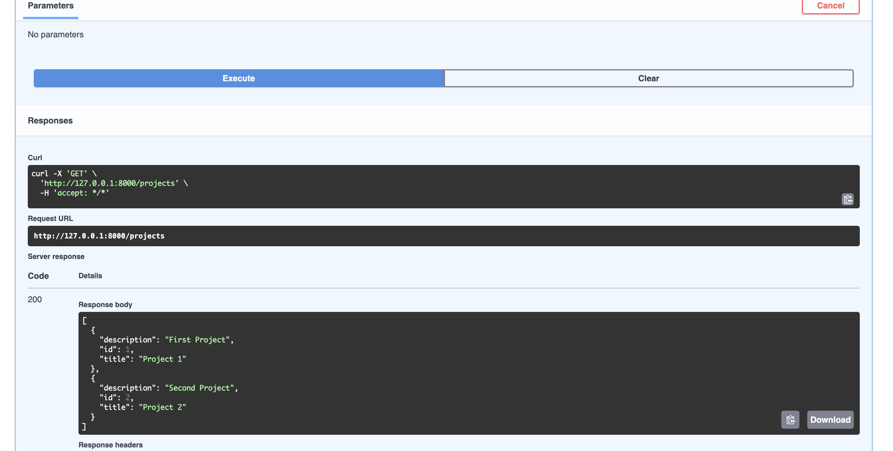

---

### 4. Task Management Workflow

#### Fetch & Query Tasks
* **All Tasks List:**  
  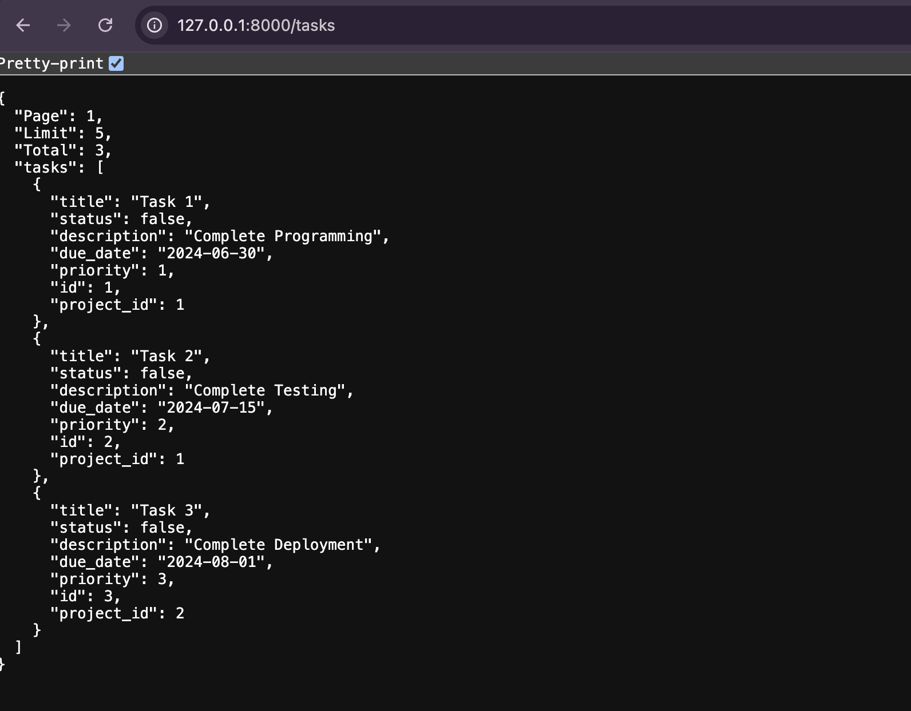

* **Get Task by ID:**  
  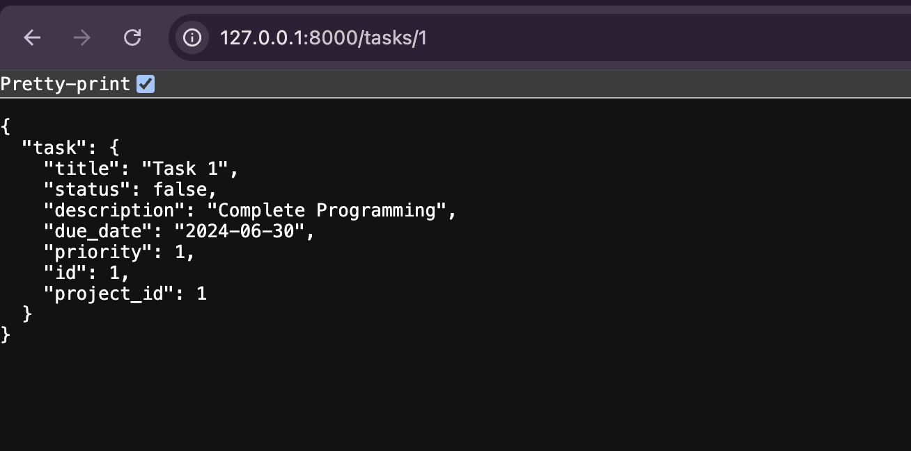

* **Get Tasks Filtered by Project:**  
  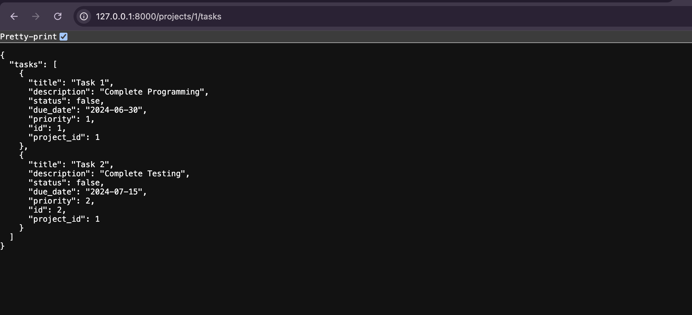

* **Get Tasks Sorted by Priority:**  
  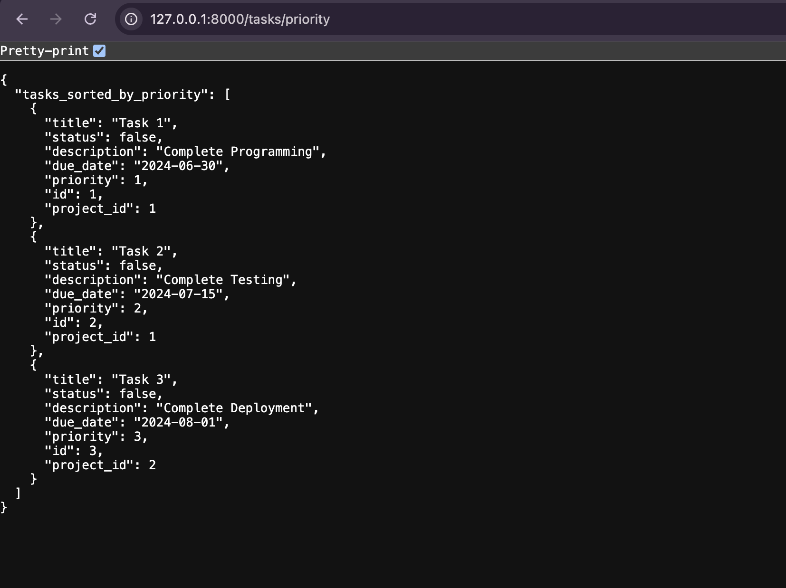

* **Get Tasks Sorted by Due Date:**  
  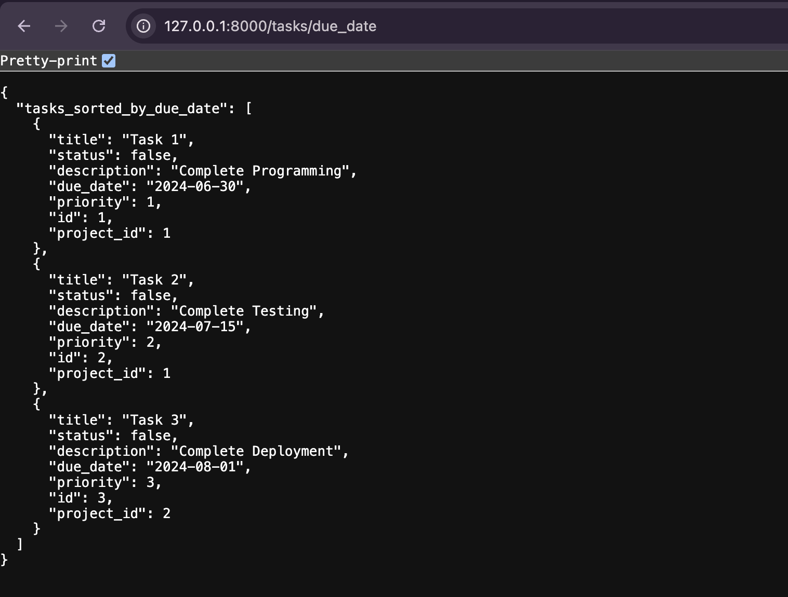

#### Create Task
* **Before Task Creation:**  
  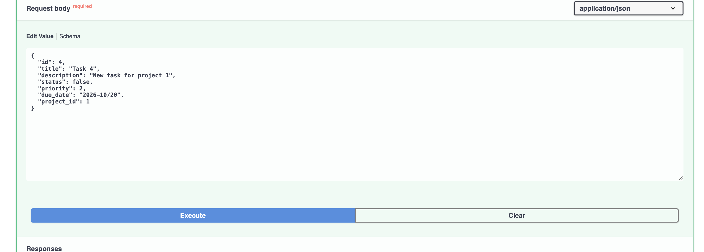

* **After Task Creation:**  
  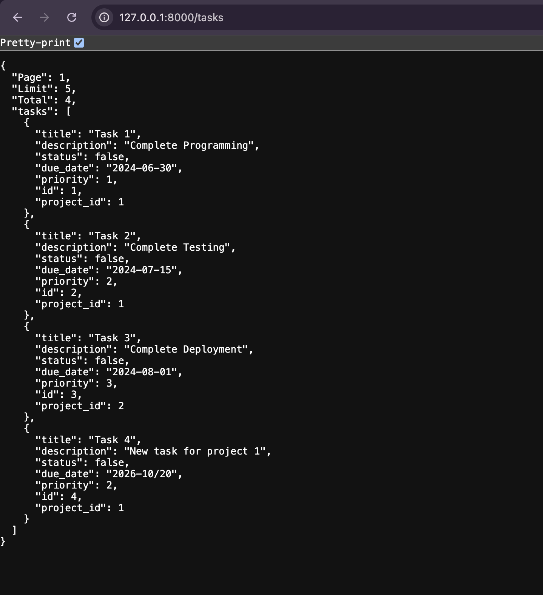

#### Update Task
* **Before Task Update:**  
  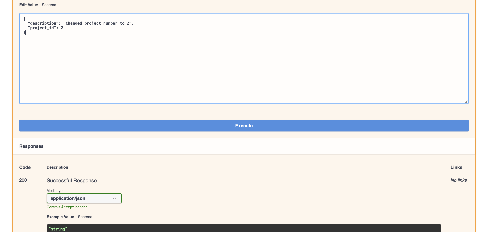

* **After Task Update:**  
  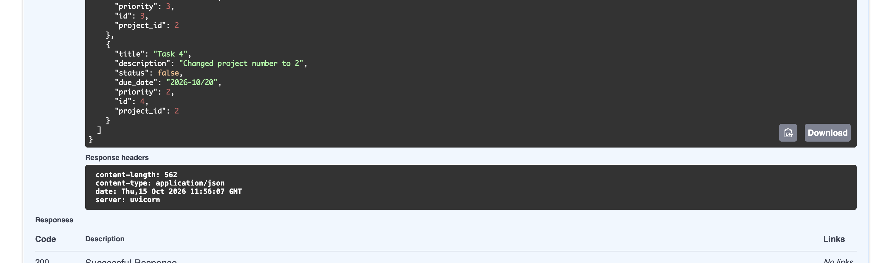

#### Delete Task
* **Deleting a Task:**  
  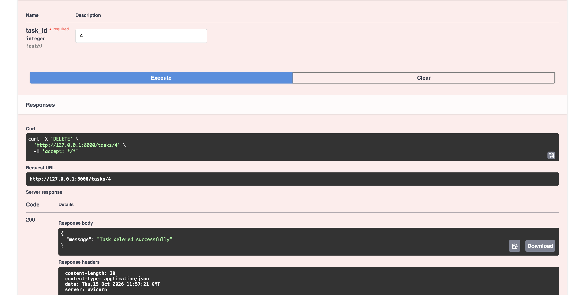

* **After Task Deletion:**  
  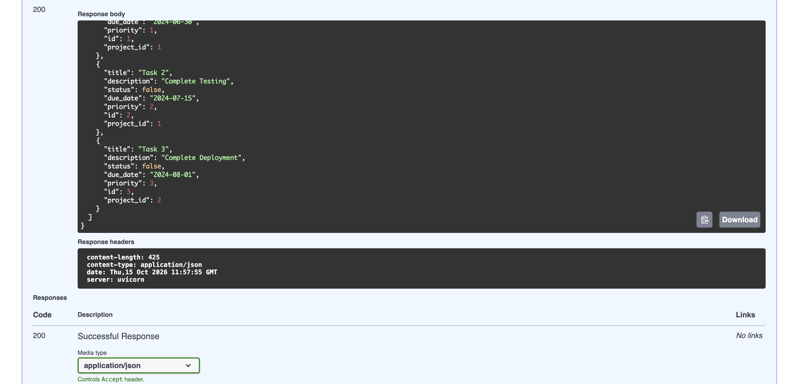
